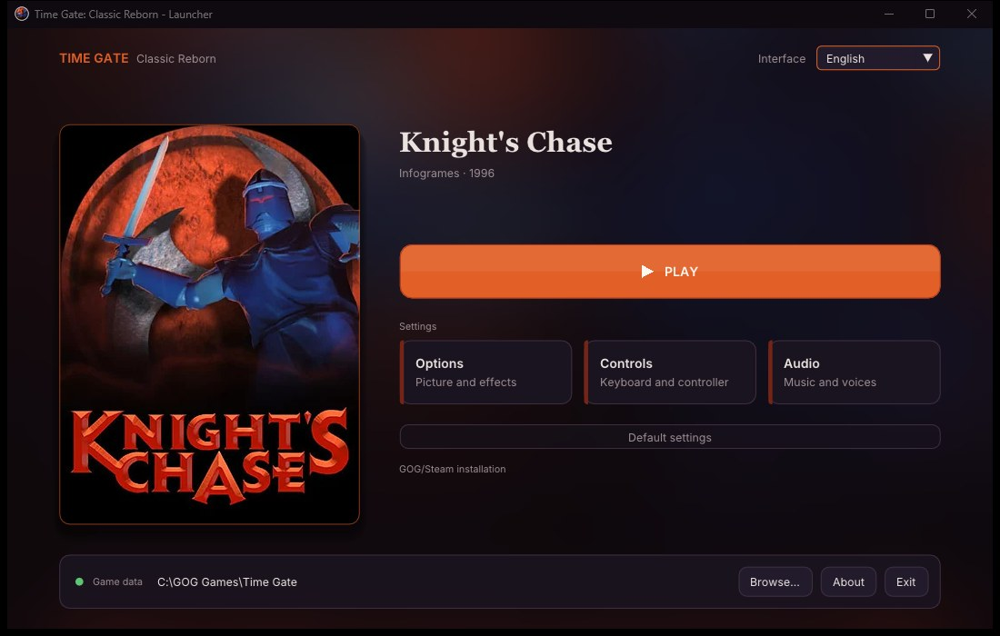

# Time Gate: Classic Reborn

Play **Time Gate: Knight's Chase** (Infogrames, 1996) on modern PCs, with its original graphics and a set of careful fixes and options.

**[⬇ Download the latest version](https://github.com/nayo186/TimeGateClassicReborn/releases/latest)** for Windows, Linux, macOS or Android (both experimental): unpack it, run `Launcher.exe` (`Launcher` on Linux and macOS) and choose your GOG copy of the game; on Android, install the app and import the game (see [On Android](#on-android-experimental)). Nothing else to install.

> **This is an alpha.** The museum and the first scenes after the journey back in time, in the prison, are playable; the rest of the game is being played through now. If something behaves differently from the original, please [report it](#reporting-a-problem): it helps a lot.

<p align="center"><br><sub>The launcher</sub></p>

Time Gate: Classic Reborn is a C++17 source port of the Infogrames engine of *Alone in the Dark* and *Time Gate*. It shares its engine with [Alone in the Dark: Classic Reborn](https://github.com/nayo186/AloneInTheDarkClassicReborn), built on [FITD (Free in the Dark)](https://github.com/yaz0r/FITD) by yaz0r. Every part of *Time Gate* that differs from the *Alone in the Dark* games was compared with the original DOS executable, `TIMEGATE.EXE`, and made to work as it does.

> **The game data is not included.** You need your own copy of *Time Gate: Knight's Chase* (the GOG edition, or the original CD). Nothing of the original game is in this repository.

## How it was made

The engine comes from FITD, which reverse engineered the DOS engine of *Alone in the Dark* into readable C++. *Time Gate* was made with a later version of that engine, so most of it is shared; what *Time Gate* does differently (textured models and their lighting, its masks, music, sound channels, videos, menus, saves, script orders...) was studied in its own executable and written here. The game's logic (doors, enemies, items, events) is not in the executable: it lives in the scripts of the game's `LISTLIFE.PAK`, which the engine interprets as the original did. `docs/TIMEGATE_EXE.md` keeps what is known of the executable, and `docs/baseline/BUGS.md` every fix with its cause (the *Time Gate* ones have the letter G).

## Requirements

**To play**

- **Windows** 10 or 11, 64-bit, and a graphics card with DirectX 11.
- Or **Linux**, 64-bit (x86-64): Ubuntu 22.04, Linux Mint 21, Debian 12, Fedora 37 or newer, or any other distribution of the same age, with a graphics card that supports Vulkan or OpenGL.
- Or **macOS** 11 or newer, Apple Silicon or Intel (experimental).
- Or **Android** 7 or newer on a 64-bit phone or tablet (experimental).
- Your own copy of *Time Gate: Knight's Chase*: the GOG edition (English, Spanish, German or Italian), or the French CD (*Time Gate : Le Secret du Templier*) with its files copied to a folder (see [Getting started](#getting-started)).
- Nothing else to install: no .NET, no Visual C++ Redistributable, no DirectX setup, no Linux packages. Unpack and run the launcher.

**To build the project**: see [Building](#building).

## What it adds

- **Fixes** to how the game looked and behaved in its source port: drawing order, masks, palettes, collisions, sounds, script orders and more (see `docs/baseline/BUGS.md`, letter G).
- **Launcher** with the cover of the game, **Play**, and windows for the options, the controls and the audio. The menus are in English, French, German, Italian and Spanish.
- **The game in five languages**: English, Spanish, German and Italian (GOG) and French (the original CD). With one edition installed, the others can be added as language folders (see [Languages](#languages)).
- **Screen options**: resolution, aspect ratio, integer scaling, fullscreen, frame limit, VSync, graphics engine, and optional effects (edge smoothing, bloom, film grain, scanlines, ambient occlusion, smoother animations, sharper text) (see [Options](#options)).
- **Custom backgrounds**: export every background, full-screen picture, mask and video of the game, enlarge or repaint them, and the game uses yours (see [Modding](#modding)).
- **Music**: the game's MIDI music played with a General MIDI soundfont; the one that comes with the game, or any other you add (see [Music](#music)).
- **Controls**: keyboard and game controller (Xbox, PlayStation, Nintendo Switch Pro and most other USB or Bluetooth controllers), every action can be changed, with a picture of the controller.
- **Separate volumes** for music and for voices and effects.
- **Saves** in the format of the GOG edition: saves made in the GOG game load here, and the other way round.
- **Game file check**: the launcher checks the files of your game folder against the editions we know and warns if one is missing or different.

## Getting started

1. Get a release (or build the project, see [Building](#building)).
2. Run **`Launcher.exe`** (next to `Tatou.exe`). On Linux and macOS: **`Launcher`** (next to `Tatou`).
3. Press **Browse** and choose your game folder:
   - the **GOG installation** of *Time Gate* (the folder with `goggame-1365065972.info`). Nothing is extracted or written there;
   - or a **copy of the game files** (a folder with `PURSUIT.PAK` and the other `.PAK` files, with the videos in its `cd/TIMEGATE` folder, as GOG installs them). For the French CD, copy the files of its `TIMEGATE` folder into a folder and its `.MUX` videos into `cd/TIMEGATE` inside it.
4. Press **Play**.

In the game, **Esc** opens the menu of coins, as in the original: new game, save, load, sound, volume, introduction, difficulty and quit.

- **Sound** chooses the soundfont of the music (see [Music](#music)); in the original it set up the sound card.
- **Difficulty** is the tarot of the original: three cards, three levels.

**Updates.** When it opens, the launcher asks GitHub for the latest release of this project and, if there is a newer one, offers to install it; the **Update** button appears when there is one. Installing replaces only the programs and the documents next to them: `UserData` (options, saves) and `launcher.cfg` are never touched. The launcher connects to the internet only for this, and the game never does.

### On Linux

1. Unpack the `.tar.gz` anywhere in your home folder (most file managers open it with a double click, or `tar -xzf TimeGateClassicReborn-<version>-linux-x64.tar.gz`).
2. Run `Launcher` from that folder (double click, or `./Launcher` in a terminal).
3. **Browse** to the game installed for Windows: with Heroic, Lutris or Wine, the game's folder inside the Wine prefix (the one with `PURSUIT.PAK`); or a copy of the game files, as on Windows. Folders whose name starts with a dot are hidden: press Ctrl+H in the folder picker to show them, or type the path.

The game runs natively, without Wine: it is only needed to install the game files. Updates from the launcher need `curl` (installed on almost every distribution).

### On macOS (experimental)

It is built for every Mac with macOS 11 or newer, Apple Silicon and Intel, from the same code as Windows and Linux. Reports from Mac players are very welcome.

1. Unpack `TimeGateClassicReborn-<version>-macos.tar.gz` (a double click in Finder) into a folder of your own, for example in **Documents** (not in **Downloads**).
2. **The first time**, macOS stops it, because it is not signed with a paid Apple developer account. Open **Terminal**, type `xattr -dr com.apple.quarantine ` (with a space at the end), drag the unpacked folder onto the Terminal window and press Return. This is needed once.
3. Double click **`Launcher`** (it opens with a Terminal window next to it; leave it open while you play).
4. **The game files.** The simplest on a Mac is to copy them into `UserData/TimeGate/GAME` (see [Folders](#folders)), from your GOG installation on a Windows PC. The launcher finds them by itself. You can also press **Browse** and choose the folder where they are.

### On Android (experimental)

**The Android version is new and experimental.** It is the same game as on the PC, with the launcher inside the app and on-screen controls; it is its own app, **Time Gate: Classic Reborn**, beside *Alone in the Dark: Classic Reborn* if you have it. It needs Android 7 or newer on a 64-bit phone or tablet, and draws with Vulkan (or OpenGL ES 3.0 where Vulkan does not start). Reports from Android players are very welcome (see [Reporting a problem](#reporting-a-problem)).

1. **Install the app.** On the phone, download `TimeGateClassicReborn-<version>-android.apk` from the [latest release](https://github.com/nayo186/TimeGateClassicReborn/releases/latest) and open it. The first time, Android asks to allow your browser (or file manager) to install apps: allow it. It is not on Google Play, so Play Protect may warn about an unknown app: choose to install anyway.
2. **Bring the game to the phone.** Copy your game folder from the PC to the phone, for example with a USB cable into **Download**: the **GOG installation** of *Time Gate* (the folder with `PURSUIT.PAK` and `cd`), or the `UserData\TimeGate` folder of Classic Reborn on your PC (with its `GAME`, `Languages` and `Saves`). Put the other languages you own inside its `Languages` folder, each in its own folder, as on the PC (see [Languages](#languages)).
3. **Import it.** In the launcher press **Import...**, go into that folder and press **Use this folder**, then **Allow**. The app copies the game (about 400 MB), its videos, languages, saves and soundfonts, showing its progress. When it says the game is imported, the copy in **Download** can be deleted. A language folder (or a folder of them) can also be imported later on its own.
4. Choose the language and press **Play**. The music's soundfont comes inside the app.

**Why import?** Android keeps each app's files to itself: the game lives in the app's own folder (`Android/data/com.classicreborn.timegate/files`, with `UserData` inside, as on the PC), and other apps cannot copy into it. Uninstalling the app deletes that folder, game and saves included.

**On-screen controls.** A semi-transparent controller over the game: the **D-pad** is the tank control, the **stick** (where you put your thumb on the left half) walks where you push it, and **A**, **B**, **Start**, **Back** and **RT** do what they do on a controller (see [Controls](#controls)). They hide when a controller or a keyboard is used, and come back with a touch. In **Controls**, the **Controller** tab is a list on the phone: tap a button to remove it, or **+ Add**. The menus work with the finger.

**Updates.** As on the PC, the launcher offers a newer version when there is one: Android asks you to update the app; accept. Your game, saves and options are kept.

## Languages

GOG sells *Time Gate* one language at a time: English, Spanish, German or Italian. The original French CD (*Time Gate : Le Secret du Templier*) is a slightly older version of the game. Any of them works as it is: choose its folder in the launcher.

**Other languages.** With one edition installed, you can play in another language you own by adding its files to a language folder: `UserData\TimeGate\Languages\<language>`, where `<language>` is `English`, `French`, `German`, `Italian` or `Spanish`. Put there the files of that edition that differ from yours (the rest is read from your installation, which is never changed):

- always `FRANCAIS.PAK` (the texts; it has this name in every language), `SAMPLES.PAK` (the voices) and `LISTLIFE.PAK` (the scripts, which call the voices and texts by number);
- the other files of that edition that differ: `ITD_RESS.PAK` (the letters, with the accents of Spanish, Italian and French), `DEFINES.ITD`, `VARS.ITD`, `PRIORITY.ITD`, `TEST.WAV`, and the videos with voices (`cd/TIMEGATE/AN*.MUX`); the French CD also changes `LISTANIM.PAK`, `OBJETS.ITD`, `CAMSAL09.PAK`, `CAMSAL15.PAK`, `MK050800.PAK` and adds `LM*.GRD` files. Copying every `.PAK`, `.ITD` and `.MUX` file of the other edition also works.

The launcher then offers that language in **Game language**. A folder without its texts, voices or scripts is not offered (`launcher.log` says what it lacks).

The language of the menus (launcher and F1) is chosen apart, with **Interface** at the top right of the launcher.

## Music

*Time Gate*'s music is MIDI: notes that a synthesizer plays. The game comes with **TimGM6mb**, a small General MIDI soundfont (a set of recorded instruments). For richer music, add any General MIDI soundfont (`.sf2`) to **`UserData\TimeGate\SoundFonts`**, for example:

- **GeneralUser GS** by S. Christian Collins: <https://schristiancollins.com/generaluser.php>
- **FluidR3_GM** by Frank Wen (included in many Linux distributions as `fluid-soundfont-gm`)

Then open the menu with **Esc**, choose the **Sound** coin and pick it from the list: the music changes at once, and the choice is kept.

## Controls

Every action can be changed in **Controls** (in the launcher, or in the game with F1). The **Controller** tab shows a picture of the controller with each button and what it does; the names change with a PlayStation or Switch controller.

| Action | Keyboard | Controller |
| --- | --- | --- |
| Move | Arrows or W A S D | D-pad or left stick |
| Run | Left Shift | Right trigger |
| Action (use, fight, take) | Space | A |
| Confirm / inventory | Enter | Start |
| Cancel / menu of coins | Esc | B |
| Options window (F1) | F1 or Home | Back |
| Fullscreen | F11 or Alt+Enter | — |

## Options

The launcher (its **Options**, **Controls** and **Audio** cards) and the in-game **F1** window share the same settings, saved in `aitd_remaster.cfg`:

| Option | What it does |
| --- | --- |
| Frames per second, VSync | Smoothness; the game speed never depends on them |
| Aspect ratio, resolution, fullscreen | How the 4:3 scene is shown |
| Graphics engine | How the picture is drawn: Direct3D 11 or Vulkan on Windows, Vulkan or OpenGL ES on Android (Linux and macOS have one). Applies the next time the game starts; try the other one if the picture looks wrong |
| Integer scaling | Every pixel of the game the same size, with black borders around (like pixel-perfect scaling in DOSBox): **Size**: Automatic, the largest that fits, or a size of your choice; **3D resolution**: how sharp the 3D models are, down to the original 320 × 200. Off by default; while it is on, Resolution is not used |
| Edge smoothing | FXAA on the 3D models |
| Bloom | A soft glow from the bright parts of the painted backgrounds |
| Film grain | A light grain over the picture |
| Scanlines | Thin dark lines over the picture, like an old CRT screen; under it, their intensity from 1 (soft) to 4 (strong) |
| SSAO | Soft shadows where surfaces meet |
| Smooth animations | Poses blended between the original key frames |
| Enhanced text | The game's letters redrawn sharp at screen resolution |
| Custom backgrounds | Uses your pictures instead of the originals (see [Modding](#modding)) |
| Audio | Music volume, voices and effects volume |
| Controls | The inputs of every action, modern left stick, controller vibration |

## Folders

Nothing is ever written to the game folder. Everything the game writes goes to **`UserData`**, next to the programs:

```
UserData/
├── aitd_remaster.cfg      options
└── TimeGate/
    ├── Saves/             saves (SAVE0.ITD ... SAVE7.ITD, as GOG names them)
    ├── tatou.log          log of the last session (tatou.prev.log: the one before)
    ├── crash_log.txt      written if the game closes by itself
    ├── SoundFonts/        your soundfonts (see Music)
    ├── Languages/         other languages, one folder each (see Languages)
    ├── Backgrounds/       your backgrounds, full-screen pictures and videos (see Modding)
    ├── Masks/             your masks (see Modding)
    ├── Exports/           what F1 exports: the game's own pictures, to use as a base
    └── GAME/              the game itself, if you keep it here
```

`launcher.cfg` and `launcher.log`, next to the launcher, keep the launcher's own settings.

**Everything in one folder (portable).** The game can also live inside `UserData\TimeGate\GAME`: copy your GOG installation there. With `UserData` and the programs in one folder, everything can be moved or copied to another computer or drive.

## Modding

The game's pictures can be replaced by your own, without changing any game file: everything goes into `UserData\TimeGate`, and removing your files brings back the originals.

- **Backgrounds**: the painted scene of every camera, and the second picture some cameras show later in the game (the museum without the alarm beams, for example).
- **Full-screen pictures**: the menu of coins, the save wall, the inventory's stained glass, the tarot of the difficulty and the other screens.
- **Masks**: the parts of a background that pass in front of the characters, for when your picture moves or redraws them.
- **Videos**: every video of the game, picture by picture, and its sound.
- **Music**: any General MIDI soundfont (see [Music](#music)).

In short: switch on **Custom backgrounds** in F1, export the game's own pictures with F1's **Export backgrounds**, **Export masks** and **Export sequences** (they go to `UserData\TimeGate\Exports`), enlarge or repaint them, and save them with the same name in `Backgrounds` or `Masks`. The game shows them at once, no restart needed.

**All the details** (names, sizes, masks, videos and how to share a mod) are in the **[modding guide](MODDING.md)**.

## Reporting a problem

Found a bug? Please open an [issue](https://github.com/nayo186/TimeGateClassicReborn/issues) and tell us:

- what happened and what you were doing (where in the game, if you can);
- on which system: **Windows**, **Linux** (and which distribution) or **macOS** (and your Mac's model);
- your edition of the game (GOG and its language, or the French CD) and the language you play in.

It helps a lot to attach these files: drag them into the issue's text box. Close the game first, so the logs are complete:

- **The logs**, in `UserData\TimeGate`, next to `Launcher.exe`: `tatou.log` (the last session), `tatou.prev.log` (the one before: if you opened the game again after the problem, the problem is in this one), `crash_log.txt` if the game closed by itself, and `launcher.log`, next to `Launcher.exe`, if the problem is in the launcher. On Android they are in `Android/data/com.classicreborn.timegate/files/UserData/TimeGate` (and `launcher.log` in `files`): connect the phone to a PC with a USB cable to copy them.
- **A save** made just before the problem, if you can: `UserData\TimeGate\Saves\SAVEn.ITD`. GitHub does not accept `.ITD` files, so put the save in a `.zip` first.
- **A video or a screenshot**, if it is something you see; and if you can, one of the same place in the GOG game, to compare.

The logs only name the game's folders and what the game did; they may show your user name inside a folder path (`C:\Users\<name>\...`). Nothing else from your PC is in them.

## Building

From the folder of the repository, on Windows with [Visual Studio 2022](https://visualstudio.microsoft.com/vs/) (the free Community edition, with the **Desktop development with C++** workload):

```
cmake -G "Visual Studio 17 2022" -A x64 -S TatouSource -B TatouSource\build\timegate -DCLASSIC_REBORN_EDITION=timegate
```

Open `TatouSource\build\timegate\FITD.sln`, choose **RelWithDebInfo x64** and build. `Launcher.exe` and `Tatou.exe` end up together in `TatouSource\build\timegate\Fitd\RelWithDebInfo`; `Launcher` is the start project.

`CLASSIC_REBORN_EDITION=timegate` builds *Time Gate: Classic Reborn*; without it, the same code builds *Alone in the Dark: Classic Reborn*.

**On Linux** (Ubuntu or Debian; other distributions have the same packages under similar names):

```
sudo apt install build-essential cmake ninja-build pkg-config \
  libx11-dev libxext-dev libxrandr-dev libxcursor-dev libxi-dev libxss-dev \
  libxfixes-dev libxinerama-dev libxtst-dev libwayland-dev libxkbcommon-dev \
  wayland-protocols libdecor-0-dev libgl1-mesa-dev libegl1-mesa-dev \
  libgles2-mesa-dev libdrm-dev libgbm-dev libasound2-dev libpulse-dev \
  libpipewire-0.3-dev libudev-dev libdbus-1-dev libibus-1.0-dev
cmake -G Ninja -S TatouSource -B TatouSource/build/linux-timegate -DCMAKE_BUILD_TYPE=RelWithDebInfo -DCLASSIC_REBORN_EDITION=timegate
cmake --build TatouSource/build/linux-timegate
```

**On macOS**: Xcode (or its Command Line Tools), CMake and Ninja, then `CLASSIC_REBORN_EDITION=timegate tools/makeRelease-macos.sh <version>`.

**Development tools.** The CMake option `CLASSIC_REBORN_DEV_TOOLS` (on by default) builds tools that only work in debug mode (`debugMode = 1` in `launcher.cfg`). For a build to share with players, turn it off with `-DCLASSIC_REBORN_DEV_TOOLS=OFF`.

**Releases.** The packages of each release are built by GitHub Actions (`.github/workflows/release.yml`): publishing a release with a tag like `v0.1.0-alpha.1` attaches `TimeGateClassicReborn-0.1.0-alpha.1-windows-x64.zip`, `...-linux-x64.tar.gz`, `...-macos.tar.gz` and `...-android.apk` to it. Locally: `powershell -ExecutionPolicy Bypass -File tools\makeRelease.ps1 -Version 0.1.0 -Edition timegate` on Windows, and `CLASSIC_REBORN_EDITION=timegate tools/makeRelease.sh 0.1.0` on Linux.

The code is organised in layers (`util/` → `platform/` → `core/` + `scripts/` → `remaster/`); `docs/MAPA_CODIGO.md` describes the folders and files, and `docs/DICCIONARIO.md` every public function (both in Spanish for now). See also [CONTRIBUTING.md](CONTRIBUTING.md).

## Credits

- **FITD (Free in the Dark)**: the reverse-engineered engine, by yaz0r and contributors: <https://github.com/yaz0r/FITD>
- **Time Gate: Knight's Chase** was created by Infogrames (1996). This project contains none of its data and is not affiliated with its rights holders.
- Libraries: [bgfx](https://github.com/bkaradzic/bgfx), [SDL3](https://github.com/libsdl-org/SDL), [SoLoud](https://github.com/jarikomppa/soloud), [Dear ImGui](https://github.com/ocornut/imgui), [zlib](https://zlib.net), and [TinySoundFont](https://github.com/schellingb/TinySoundFont) by Bernhard Schelling, which plays the music.
- **TimGM6mb**, the soundfont that comes with the game, by Tim Brechbill, under the GNU GPL v2 (`TimGM6mb-copyright.txt` next to the programs).
- **Inter**, the menus' font, by Rasmus Andersson and the Inter Project Authors, and **Gelasio**, by Eben Sorkin and the Gelasio Project Authors, both under the SIL Open Font License 1.1 (`Inter-OFL.txt` and `Gelasio-OFL.txt` next to the programs).

## License

GNU General Public License v2: see [LICENSE](LICENSE). The libraries in `TatouSource/ThirdParty` keep their own licenses.
